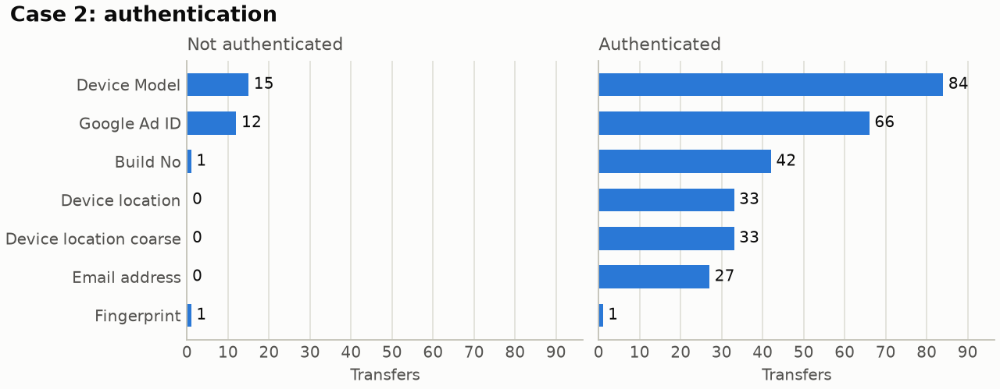

# android-traffic-analysis

[](https://github.com/sergiooriola/android-traffic-analysis/actions/workflows/ci.yml)
[](LICENSE)

Analysis code and dataset from my bachelor's thesis (ETSI de Telecomunicación,
Universidad Politécnica de Madrid, 2024): which personal data Android apps send over the
network, to how many domains, and how much of it a test actually observes depending on how
the app is exercised.

The traffic of each app was intercepted and every request labelled with the type of
personal data (PII) it carried. This repository takes those labelled logs, aggregates
them, and compares three pairs of testing conditions.



*Case 2: the same five apps, without and with a signed-in user. Email addresses and
location only leave the device once the user is authenticated.*

## The three cases

| Case | Question | Groups compared |
|---|---|---|
| 1. Interaction tool | Does the way an app is exercised change what a test observes? | Exerciser Monkey (random events), Appium (scripted), manual use |
| 2. Authentication | What stays hidden if the test never signs in? | Not authenticated, authenticated |
| 3. Dynamic vs idle | Do apps keep sending personal data when nobody is using them? | App in use, app left idle |

## Results

Counts over the shipped dataset (`data/results.json`). They are regenerated by
`traffic-analysis report` and pinned by the test suite.

| Case | Group | Apps | PII transfers | Unique transfers | PII types | Receiving domains |
|---|---|---:|---:|---:|---:|---:|
| 1 | Exerciser Monkey | 18 | 128 | 51 | 6 | 13 |
| 1 | Appium | 18 | 105 | 52 | 5 | 16 |
| 1 | Manual | 19 | 242 | 79 | 7 | 18 |
| 2 | Not authenticated | 5 | 29 | 17 | 4 | 9 |
| 2 | Authenticated | 5 | 286 | 71 | 7 | 27 |
| 3 | Dynamic | 20 | 194 | 86 | 6 | 23 |
| 3 | Idle | 20 | 196 | 108 | 8 | 26 |

- **Manual use surfaces what automated tools miss.** Manual sessions recorded about twice
  the transfers of either automated tool, and 42 location transfers against 3 for each of
  them.
- **Signing in changes the picture.** The authenticated sessions recorded roughly ten
  times the transfers of the unauthenticated ones, to three times as many domains. Email
  addresses (27 transfers) and location (33) appear only after sign-in.
- **Idle apps are not quiet.** Left untouched, the apps sent as much personal data as
  while in use (196 against 194 transfers), and Wi-Fi router identifiers appear only in
  the idle captures.

A transfer is one intercepted request carrying personal data. A *unique* transfer is a
distinct combination of PII type, domain and source port. The PII types found are the
Google advertising ID, device model, build number, fingerprint, location and coarse location,
email address, and the MAC address and BSSID of the Wi-Fi router.

## Run it

Requirements: Python 3.10+.

```bash
git clone https://github.com/sergiooriola/android-traffic-analysis && cd android-traffic-analysis
python -m venv .venv && source .venv/bin/activate   # Windows: .venv\Scripts\activate
pip install -e ".[dev]"

traffic-analysis report            # tables to the terminal, figures to figures/
traffic-analysis report --case case2 --out docs/figures
```

Each case produces three figures: the headline counts, the transfers by PII type, and a
heatmap of transfers by app and PII type.

To rebuild the dataset from raw captures:

```bash
traffic-analysis parse /path/to/logs --output data/results.json
```

The parser expects one folder per capture campaign (`logging`, `loggingAppium`,
`loggingManual`, `loggingAuthMonkey`, `loggingAuthManual`, `loggingDynVsIdle`) with logs
at `<campaign>/<app>/<run>/*-Results-{dynamic,idle}-mitm.log`. Each log is JSON lines,
one request per line, with a `PII` field (`No-PII` when the request carries none), a
`host` and a `port_source`.

## Data

`data/results.json` holds the aggregate of every campaign, keyed by campaign and app.
For each phase (`dynamic`, `idle`) an app records:

| Field | Content |
|---|---|
| `<phase>_no_pii_count` | Requests without personal data |
| `<phase>_other_pii_count` | Requests with personal data |
| `<phase>_other_pii_values` | Requests per PII type |
| `<phase>_unique_domains` | Distinct `[domain, source port]` pairs that received personal data |
| `<phase>_detailed_transfers` | One `{pii_type, domain, port}` entry per transfer |

The file contains the *type* of each piece of personal data and where it was sent, never
its value. The raw captures and the interception and labelling pipeline that produced
them are not part of this repository.

## Project structure

```
src/traffic_analysis/
├── parsing.py   # raw logs -> aggregated results, load/save
├── cases.py     # the three cases and the groups each one compares
├── metrics.py   # tables: headline counts, by PII type, by app
├── plots.py     # figures drawn from those tables
└── cli.py       # `traffic-analysis parse | report`
data/            # aggregated dataset
docs/figures/    # figures of the three cases
tests/           # parser and metrics unit tests, regression tests on the dataset
```

## Testing and CI

```bash
pytest
ruff check .
```

The parser and the metrics are unit-tested on synthetic logs, and a regression test pins
every number in the results table to the shipped dataset. GitHub Actions runs lint and
tests on every push and pull request.

## Limitations

- **Small samples.** Each condition covers 18 to 20 apps, and case 2 only 5. The results
  are descriptive counts; the samples are too small for significance testing, so none is
  reported.
- **One capture per condition.** There are no repeated runs, so run-to-run variation is
  not measured.
- **Case 2 changes two things at once.** The unauthenticated captures were driven by
  Exerciser Monkey and the authenticated ones manually, so the effect of signing in is
  not separated from the effect of the interaction mode measured in case 1.
- **Ports are source ports.** The logged port is the client's, so a (domain, port) pair
  identifies a connection, not a server endpoint. *Receiving domains* is the count to
  read as "how many third parties".

## License

[MIT](LICENSE)
